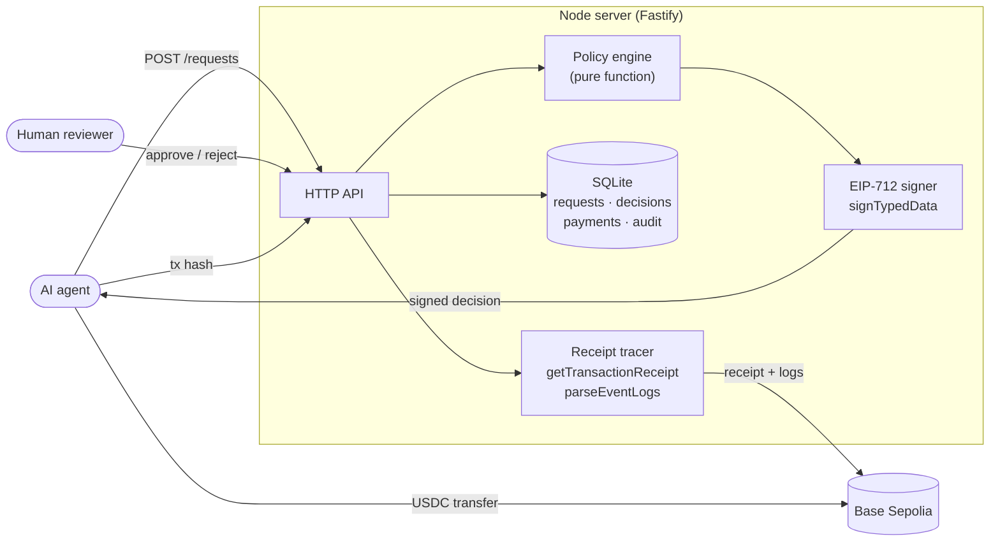

# Mandate

**Agent spend approvals with onchain receipts.**

An AI "agent" asks to spend X USDC to address Y. Mandate checks the request against a human-defined policy and returns a **signed decision**. Approved payments are then matched to a **real USDC transfer on Base Sepolia**, and a dashboard shows the whole trail: request → decision(s) → transaction.

> **Honest framing:** this is a testnet learning project modelled on agent-payment controls. It is not a production system, has no authentication, and never touches real money. See [Limitations](#limitations).

Stack: TypeScript everywhere · React (Vite) · Node + Fastify · [viem](https://viem.sh) · SQLite (`node:sqlite`) · Vitest · Base Sepolia.

## How it works



1. **Policy engine** (`server/src/policy.ts`): a pure function, `(request, mandate, spentToday) → approved | denied | needs_approval`, with reasons.
2. **Signed decisions** (`server/src/signing.ts`): every decision is an EIP-712 typed-data message signed by the server key. `POST /verify` checks it with `verifyTypedData`; a third party only needs `GET /signer` to verify offline.
3. **Approvals queue** (React): requests waiting on a human, approve/reject buttons, and a decision log.
4. **Onchain tracing** (`server/src/tracing.ts`): given a tx hash, fetch the receipt, decode USDC `Transfer` events, and check amount + recipient (+ sender, if the mandate names a wallet). Status: `pending → confirmed` or `mismatch`, with a BaseScan link.
5. **Dashboard**: spend per agent vs. daily limit, pending approvals, and a per-payment audit trail.

## Policy rules

A mandate belongs to one agent and holds: `perPaymentLimit`, `dailyLimit` (UTC day), an optional `approvalThreshold`, an `allowedRecipients` list, and an optional `walletAddress` (the agent's paying wallet).

| Tier | Rule | Result |
| --- | --- | --- |
| Hard | No mandate, or mandate paused | `denied` |
| Hard | Amount ≤ 0 | `denied` |
| Hard | Amount > per-payment limit | `denied` |
| Hard | Today's approved spend + amount > daily limit | `denied` |
| Soft | Recipient not on the allowlist (an empty list means *everyone*) | `needs_approval` |
| Soft | Amount > approval threshold | `needs_approval` |
| — | Nothing above fires | `approved` |

Hard rules win over soft rules, and all failing hard rules are reported. A human **cannot** approve past a hard limit: approving a queued request re-checks the hard rules against today's spend and returns `409` if the request would now break one (it stays in the queue so it can be rejected). Only approved requests count toward the daily limit. Queued and denied ones don't.

## Run it

Requires **Node ≥ 22.13** (uses the built-in `node:sqlite`, so there is no native addon to compile).

```bash
npm install
cp .env.example server/.env        # optional: defaults work for local dev
npm run seed                        # demo agents + a spread of requests
npm run dev                         # API on :8787, web on :5173
```

Open http://localhost:5173. With no `SIGNER_PRIVATE_KEY`, a dev signing key is generated once into `server/data/signer.key` (gitignored). In production the key is required.

### Getting real onchain data (the interesting part)

1. Create a **throwaway** wallet and put its key in `server/.env` as `SENDER_PRIVATE_KEY`. Never use a key that holds real funds.
2. Get Base Sepolia ETH (gas) from a faucet, and testnet USDC from [faucet.circle.com](https://faucet.circle.com) (choose *Base Sepolia*).
3. Seed with a recipient you control: `SEED_RECIPIENT=0xYourOtherWallet npm run seed` (delete `server/data/` first to re-seed).
4. Approve a request in the UI, then send exactly that amount:
   ```bash
   npm run send-usdc -w server -- 0xRecipient 10
   ```
5. Paste the printed tx hash into the request's **Onchain payment** panel. Try sending the wrong amount or recipient to see `mismatch`.

USDC on Base Sepolia is `0x036CbD53842c5426634e7929541eC2318f3dCF7e` ([Circle's address list](https://developers.circle.com/stablecoins/usdc-contract-addresses)); override with `USDC_ADDRESS`.

## API

| Method & path | Purpose |
| --- | --- |
| `PUT /mandates/:agentId` | Create/update a mandate (amounts as decimal USDC strings) |
| `POST /requests` | **Agent call.** `{agentId, recipient, amount, memo?}` → request + signed decision |
| `GET /requests?status=` · `GET /requests/:id` | List, or full detail (decisions, payment, audit events) |
| `POST /requests/:id/resolve` | Human `{action: "approve" \| "reject", actor}` |
| `POST /requests/:id/payment` | Attach `{txHash}` to an approved request and trace it |
| `POST /requests/:id/payment/recheck` | Re-run the onchain check (e.g. was still pending) |
| `POST /verify` | `{message, signature}` → `{valid}` via `verifyTypedData` |
| `GET /signer` | Signer address + EIP-712 domain/types, for offline verification |
| `GET /summary` · `GET /decisions` | Dashboard data · decision log |

Verifying a decision yourself, knowing only the server's address:

```ts
import { verifyTypedData } from 'viem';

const { address, domain, types } = await (await fetch(`${API}/signer`)).json();
const ok = await verifyTypedData({
  address, domain, types, primaryType: 'Decision',
  message: { ...decision.message, amount: BigInt(decision.message.amount), issuedAt: BigInt(decision.message.issuedAt) },
  signature: decision.signature,
});
```

## Tests and CI

```bash
npm test          # Vitest: policy, signing, tracing, and API integration (72 tests)
npm run lint && npm run typecheck && npm run build
```

GitHub Actions (`.github/workflows/ci.yml`) runs lint, typecheck, tests, and the web build on every push and PR.

- **Policy**: boundaries (inclusive limits), hard-beats-soft precedence, empty allowlist, case-insensitive addresses.
- **Signing**: round-trip; tampering with *any* signed field (amount, recipient, outcome, id, timestamp) fails; wrong key fails; malformed signatures return `false` rather than throwing.
- **Tracing**: confirmed / pending / reverted / wrong recipient / wrong amount (over and under) / wrong sender; **fake-token `Transfer` events are ignored**; multi-transfer transactions.
- **API**: queue flow, one-time resolution, human can't override hard limits, UTC-day rollover, **concurrent requests can't race past the daily limit**, tx-hash reuse across requests is refused, RPC failure yields `502` and records nothing.

Tracing tests use receipts built with viem's own `encodeEventTopics` / `encodeAbiParameters`, i.e. byte-for-byte what the chain emits, but against a fake client, not a live chain. The path against real Base Sepolia is exercised by the manual steps above.

## Design decisions worth discussing

- **Typed data, not a signed JSON string.** EIP-712 gives one canonical encoding, a domain separator (a signature for Mandate can't be replayed elsewhere), and standard tooling on the verifying side.
- **`parseEventLogs` doesn't check the emitting contract.** Anyone can deploy a contract that emits a lookalike `Transfer`. The tracer filters `log.address === USDC` before trusting any event.
- **Exact bigint money.** USDC has 6 decimals. Amounts are base-unit integers end to end (stored as strings, never floats), parsed with `parseUnits`.
- **Check-then-insert is one synchronous transaction.** The policy read of "spent today" and the insert of the request happen with no `await` between them, so concurrent requests can't both pass the daily limit. (Signing is async, so it happens right after, on an already-committed row.)
- **Replay protection.** `payments.tx_hash` is `UNIQUE`: one transaction can't "pay" two requests.
- **An RPC error is not a verdict.** Network failures surface as `502` and record nothing; only a mined receipt can produce `confirmed`/`mismatch`.
- **Optional sender check.** If the mandate lists the agent's wallet, the transfer must come *from* it, so someone else's matching transfer can't be claimed as the agent's payment.

## Limitations

This is deliberately small. Not done, and what it would take:

- **No authentication.** Anyone who can reach the API can submit requests or approve them. Real use needs per-agent API keys / signed requests and authenticated reviewers.
- **Mandates are editable by anyone** via `PUT /mandates/:id`, for the same reason.
- **The server doesn't move money.** It decides and traces; it never holds keys that can spend. A real system would make the executor *require* a valid signed decision before releasing funds.
- **"Confirmed" means mined and matching**, not final. No confirmation-depth or reorg handling beyond a manual recheck.
- **Single process, single SQLite file.** Fine for a demo, not for horizontal scale. The atomicity argument above relies on that.
- **`node:sqlite` is experimental** in Node 22 (you'll see a warning).
- Decimals-only USDC amounts; no multi-token or multi-chain support.

## Deploying (not yet done)

- **API** (Render/Fly/Railway): `npm ci`, start with `npm start -w server`. Set `NODE_ENV=production`, `SIGNER_PRIVATE_KEY`, `RPC_URL`, `CORS_ORIGIN` (your web origin), and point `DB_PATH` at a persistent disk (otherwise the database resets on redeploy).
- **Web** (Vercel/Netlify): root `web/`, build `npm run build`, output `dist`, and set `VITE_API_URL` to the API origin.

## Layout

```
server/src/   policy.ts · signing.ts · tracing.ts   ← the three core modules
              service.ts (orchestration) · store.ts + db.ts (SQLite) · app.ts (routes)
server/test/  policy · signing · tracing · api
server/scripts/  gen-key.ts · send-usdc.ts
web/src/      App.tsx · api.ts · pages/{Dashboard,Approvals,Requests,Simulator}.tsx
docs/WALKTHROUGH.md   file-by-file guide and interview prep
```
